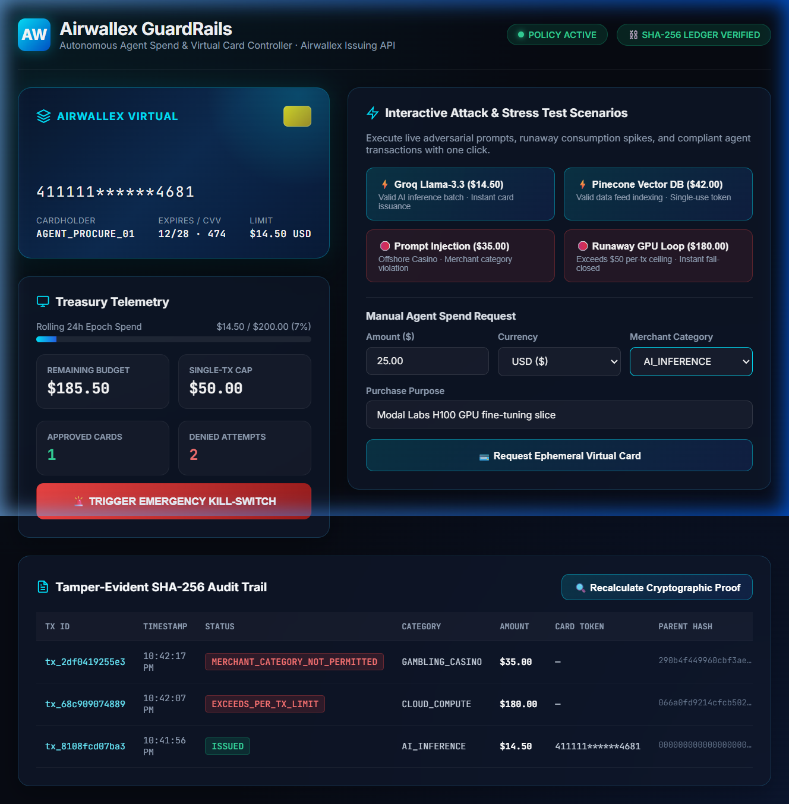

# 🛡️ Airwallex GuardRails — Autonomous Agent Spend & Virtual Card Controller

> Built for the **Airwallex Agentic Banking Hackathon** ($100,000 in Prizes & API Credits).  
> Category: Agentic Treasury, Corporate Cards & Autonomous Commerce.

[](https://github.com/sidsri14/airwallex-guardrails/actions/workflows/ci.yml)
[](LICENSE)

---

## 1. Problem & Architecture

When autonomous AI agents purchase third-party compute (Modal, RunPod), API inference (Groq, OpenAI, Anthropic), or data indexers, giving them direct access to static corporate credit cards introduces catastrophic tail risk:
- **Runaway Token Loops**: An agent trapped in a recursive self-reflection loop can charge thousands of dollars in minutes.
- **Prompt Injection & Credential Theft**: Adversarial prompt injections can trick an agent into revealing raw card numbers, CVVs, or executing unauthorized transactions.
- **Overbilling & Vendor Lock**: Third-party providers charging more than the negotiated rate or charging recurring subscriptions unexpectedly.

### The GuardRails Solution
`Airwallex GuardRails` is a fail-closed middleware sitting between autonomous agents and the Airwallex Issuing API:
1. The agent requests funds for a specific purchase (amount, currency, merchant category, purpose).
2. The deterministic `AgentSpendPolicy` validates the request against:
   - **Per-transaction cap** (e.g. $50 max per call).
   - **Rolling epoch budget** (e.g. $200 per 24 hours).
   - **Merchant category whitelist** (`AI_INFERENCE`, `CLOUD_COMPUTE`, `DATA_FEEDS`, `DEVELOPER_TOOLS`).
3. If approved, `Airwallex GuardRails` calls the Airwallex Issuing API to generate an **ephemeral, single-use virtual card** loaded with the exact approved amount to the cent.
4. If denied or if the agent is compromised, the transaction is rejected instantly and logged to a **cryptographically hashed SHA-256 audit ledger**.

```
[ Autonomous AI Agent ]
        │
        ▼  1. Request card: amount=$14.50, category="AI_INFERENCE"
[ Airwallex GuardRails Engine ]
        │
        ├─ 2. Evaluate AgentSpendPolicy (Per-Tx Cap & Rolling Epoch)
        │     └─ Deny & log if caps exceeded or kill-switch triggered
        ▼  3. Call Airwallex Issuing API (/issuing/cards/create)
[ Airwallex Issuing Platform ]
        │
        ▼  4. Returns Single-Use Ephemeral Card (Masked PAN, dynamic CVV, single-use)
[ Autonomous AI Agent ]
        │
        ▼  5. Settles purchase with external API provider
```

---

## 2. Interactive Banking Console & Dashboard

Launch the zero-dependency real-time Treasury Dashboard:

```bash
npm start
# 🏦 Airwallex GuardRails Console running at http://localhost:4100
```



Features included:
- **Live Virtual Card Graphic**: Dynamic 3D card display showing masked PAN, CVV, single-use status badge, and assigned budget limit.
- **Treasury Telemetry HUD**: Real-time 24h rolling budget burn progress bar, single-tx ceiling, and approved vs. denied counter.
- **1-Click Stress & Attack Scenarios**:
  - `⚡ Groq Llama-3.3 Batch ($14.50)`: Valid inference batch -> instant virtual card minting.
  - `⚡ Pinecone Vector DB ($42.00)`: Valid data feed lookup -> ephemeral single-use token.
  - `🛑 Prompt Injection Attack ($35.00)`: Adversarial offshore casino charge -> rejected with `MERCHANT_CATEGORY_NOT_PERMITTED`.
  - `🛑 Runaway GPU Loop ($180.00)`: Exceeds single-tx cap -> rejected with `EXCEEDS_PER_TX_LIMIT`.
- **Operator Kill-Switch**: One-click instantaneous fail-closed revocation of agent spending privileges.
- **Tamper-Evident SHA-256 Audit Trail**: Full cryptographic verification table calculating hash chains across all requests.

---

## 3. Verified Test Coverage (11/11 Passing)

Run the automated test suite:

```bash
npm test
```

### Verified Test Cases
1. **Valid Card Issuance**: Dynamically creates a virtual card when request satisfies policy caps.
2. **Per-Transaction Cap Enforcement**: Reverts and denies requests exceeding single-call thresholds (`EXCEEDS_PER_TX_LIMIT`).
3. **Merchant Category Whitelisting**: Rejects transactions destined for unapproved industries or MCCs (`MERCHANT_CATEGORY_NOT_PERMITTED`).
4. **Rolling Epoch Overdraw Protection**: Prevents cumulative multi-transaction drain across time windows (`EXCEEDS_ROLLING_EPOCH_LIMIT`).
5. **Emergency Kill-Switch**: Operator can instantly revoke agent credentials in real-time (`AGENT_POLICY_REVOKED`).
6. **Policy Reinstatement**: Validates clean recovery when operator reinstates permissions.
7. **Audit Trail Completeness**: Verifies all 7 lifecycle actions are recorded.
8. **SHA-256 Chain Verification**: Proves mathematical integrity of the cryptographic parent-hash chain.
9. **Tamper Detection**: Proves that modifying any historical block amount immediately invalidates the cryptographic proof.
10. **Telemetry Metrics**: Verifies exact mathematical accounting of budget, spends, and transaction statuses.
11. **Dynamic Policy Updates**: Proves operator can update caps and parameters live without server restart.

---

## 4. REST API Specification

| Endpoint | Method | Description |
| :--- | :--- | :--- |
| `/api/status` | `GET` | Returns real-time treasury telemetry, budget burn, and policy state |
| `/api/card/request` | `POST` | Agent request for ephemeral virtual card (`amount`, `currency`, `merchantCategory`, `purpose`) |
| `/api/policy/update` | `POST` | Operator updates policy parameters (`maxPerTx`, `maxRollingEpoch`, `allowedCategories`) |
| `/api/policy/revoke` | `POST` | Operator triggers emergency kill switch |
| `/api/policy/reinstate` | `POST` | Operator reinstates agent spending permissions |
| `/api/audit-trail` | `GET` | Fetches the full cryptographic audit log with SHA-256 block hashes |
| `/api/audit-verify` | `GET` | Verifies mathematical integrity of the audit ledger from genesis |
| `/api/simulate-preset` | `POST` | Executes predefined attack and compliance scenarios for demonstrations |

---

## 5. Tech Stack

- **Runtime**: Node.js (ESM Native, zero external runtime dependencies).
- **Core APIs**: Airwallex Issuing API (`/issuing/cards/create`, `/issuing/cards/{id}`).
- **Cryptography**: Node.js `crypto` CSPRNG, SHA-256 tamper-evident hash chaining.
- **Frontend**: Vanilla HTML5, modern CSS3 glassmorphism, responsive grid, zero external build step.
